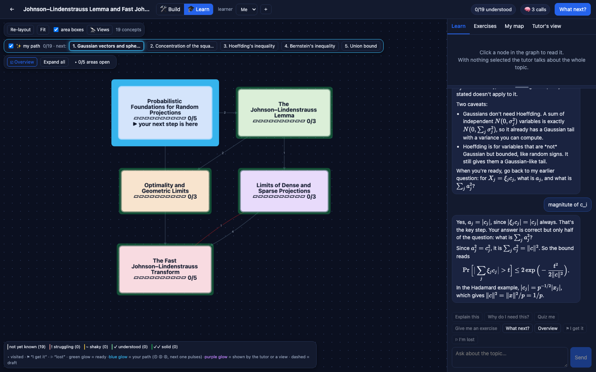
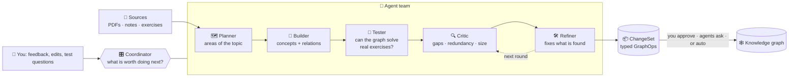
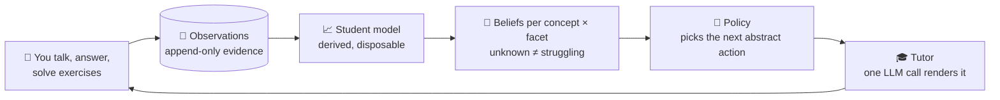

<div align="center">

# 🧠 hoc-ai

### A team of AI agents builds a map of a subject. A tutor walks you through it until you *actually* understand it.

*Not a chatbot that answers questions. A learning system that knows what you know, what you only think you know, and what to learn next.*

</div>

<p align="center">
  
</p>

---

## ✨ What it does

| | |
|---|---|
| 🏗️ **Agents build the map** | Give it a topic, PDFs or notes. A team of agents turns them into a **concept graph**: concepts, prerequisites, misconceptions and exercises. |
| 🧭 **A real learning path** | No more jumping around. The path is a topological order that finishes one area before opening the next. It glows on the graph, and you can set a goal concept to get only what leads to it. |
| 🔬 **Understanding, not memorising** | Every concept is tracked in four facets: **recall, apply, explain, transfer**. Being able to compute with a formula and being able to say why it works are different things. The system tells them apart. |
| 🎓 **A tutor that renders decisions** | A policy decides *what* to do next (explain, quiz, practise, move on) and logs why. The tutor only writes the words, with **at most one LLM call per message**. |
| 🪐 **Super-nodes and lenses** | Big topics open as a few large areas. Click one and its sub-concepts unfold. Agents can also propose temporary *lenses* (subgraphs) that light up part of the map. |
| 🧾 **Auditable, no black box** | Every graph change is a reviewable **ChangeSet** with author, rationale, evidence and confidence. Every belief about you traces back to observations. |

---

## 🤖 The agentic part

Free-roaming multi-agent systems are hard to debug, so this one isn't free-roaming. It is a **small team with strict roles**. Agents *propose*. Only the `BuildEngine` turns proposals into ChangeSets.



**Why this works better than one big prompt**

- 🧪 **The graph is tested, not just written.** Test exercises are traced through it. If a solution needs a concept the graph lacks, that is a concrete gap, not a vibe.
- ✂️ **Simplicity is rewarded.** Budgets on areas, concepts per area and findings, plus automatic **pruning of redundant prerequisite edges**, keep the graph readable instead of sprawling.
- 💸 **Cheap by design.** Agents see an *outline* of the graph and full cards only for what they are looking at. The critic reviews only what changed. On a 139-concept project that cut graph text per step from ~203k to ~50k characters, and a live from-scratch build used about **77% fewer input tokens** than the earlier approach.
- 🧑‍⚖️ **You stay in control.** Approve everything, let agents ask you, or run fully automatic. Pause or step the team, click any node to edit it, and scrub the history slider.

---

## 🧠 How it knows what you understand



- **Evidence is insert-only.** Beliefs are *derived* from it and can be deleted and recomputed with a different student model at any time.
- **"We don't know yet" is not "you don't understand".** The map keeps them apart: grey is unknown, red struggling, amber shaky, green understood.
- **Opening a node is not evidence.** Only things you actually say or do count.
- **See the tutor's reasoning.** *My map* shows what the system believes and why. *Tutor's view* shows exactly what the tutor was given.

---

## 🎬 Showcase

| You see | What it means |
|---|---|
| 🔵 **Blue glow** | Your path. The next step pulses, and steps are numbered ①②③. |
| 🟢 **Green glow** | Ready to learn: all essential prerequisites are met. |
| 🟣 **Purple glow** | Shown temporarily by the tutor or a view (*"look at these three concepts"*). |
| 🟦 **Super-nodes** | Areas of the topic. Click to open one and fly the camera in. |

The screenshot above is a topic built from scratch by the agent team (Johnson–Lindenstrauss lemma). To try it with no API key and no cost, set every role to the recorded `demo` provider in **Setup**.

---

## 🧱 Design in one line

> **Proposals, not mutations · evidence is immutable, state is derived · knowledge / assessment / learner / analytics never mix · the policy decides, the tutor only renders.**

The full rationale, invariants and the critical look at the vision are in [`docs/ARCHITECTURE.md`](docs/ARCHITECTURE.md). Notable decisions are in [`docs/adr/`](docs/adr/), including [cost, simplicity and paths](docs/adr/0013-cost-simplicity-and-paths.md).

---

## 🚀 Getting started

```bash
uv sync                      # or: python -m venv .venv && pip install -e . pytest ruff mypy types-PyYAML types-networkx
export HOC_DB=data/hoc.db    # optional; default comes from config/default.yaml
uv run hoc init
uv run hoc demo seed         # loads a tiny intro-probability graph
uv run hoc graph show
uv run streamlit run app/Home.py   # web UI: graph explorer + change history/review actions
```

### Graph Studio (agents build a graph while you watch)

```bash
uv run hoc serve             # http://127.0.0.1:8000 — create a topic, add PDFs/notes, press Start
```

Pick *I approve everything* / *Agents ask me* / *Fully automatic*, pause or step the team, click any
node to inspect or edit it, leave feedback on anything, add test questions, and scrub the history
slider. To try it without an API key or cost, set every role to the `demo` provider in **Setup**
(`demo:x`): it replays a recorded run.

**Any LLM:** providers live in `config/default.yaml` under `llm.providers` (Anthropic, OpenAI,
OpenRouter, Gemini, Ollama, any OpenAI-compatible server). Keys come from environment variables
(`ANTHROPIC_API_KEY`, `OPENAI_API_KEY`, …). Choose models per agent role in the UI as
`provider:model`, e.g. `openai:gpt-5.1` or `ollama:qwen3:32b`.

### Learning from the graph

Open a topic and switch **Build | Learn** (top bar). In **Learn**, click a node to read it, talk to the
tutor about it (quick actions: explain, why it matters, quiz me, exercise, what next), and watch the
node colours: grey = unknown, red = struggling, amber = shaky, green = understood, with a dot for
visited and ⚑/⚐ for your own "I get it / I'm lost". Large graphs open as area super-nodes; click one
to expand it. **My map** shows what the system believes, per facet, with the evidence behind it,
lets you re-derive beliefs with another student model, and exports everything as JSON lines;
**Tutor's view** shows exactly what the tutor was given and why it answered as it did.
Upload an exercise sheet in **Build → Materials** and the agents link its exercises to concepts.
Each tutor message costs at most one model call (budgets: `learn.budget`).

Everything except agent runs and tutoring (store, CLI, tests) works without an API key.

## Quality gates (run before every commit)

```bash
uv run ruff check . && uv run ruff format --check .
uv run mypy                  # strict
uv run pytest                # includes the architecture/dependency-direction test
HOC_LIVE=1 uv run pytest -m live   # optional real-API smoke test
```

## Layout

| Path | Role |
|---|---|
| `src/hoc/core` | Domain types (pydantic). No I/O, no dependencies on other hoc packages. |
| `src/hoc/store` | SQLite store, `GraphTx` write path, ChangeSet lifecycle, `KnowledgeGraph` read model, snapshots. |
| `src/hoc/llm` | `LLMClient` (prompt registry, structured output, cache, retry, call log) and backends. |
| `src/hoc/learner`, `policy`, `assess`, `tutor` | Student models, pedagogical policy, task bank and graders, the one-call tutor engine. |
| `src/hoc/ingest` | PDF/text parsing and chunking. |
| `src/hoc/construct` | The agent team, coordinator, triage, validators, draft-op compiler, engine. |
| `src/hoc/services` | `HocApp`, `TopicWorkspace`, `ProjectManager`, `Runner`. The only API the CLI/web depend on. |
| `src/hoc/web` | FastAPI API + SSE and the Studio SPA (`static/`, no build step). |
| `src/hoc/cli.py`, `app/` | Interfaces: Typer CLI and the older Streamlit explorer. Thin. |
| `prompts/<step>/vN.md` | Versioned prompt templates. |
| `config/default.yaml` | Model tiers, per-step tiers, retry/cache settings, pricing. |
| `docs/adr/` | Architecture decision records. Add one when you make a non-obvious decision. |

## Status

M0 (foundation), M0b (Graph Studio) and the learning side (L-M0…L-M6) done. See the plan for what remains.
