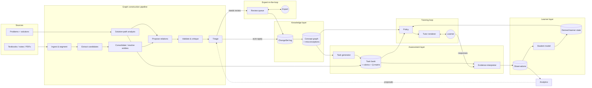
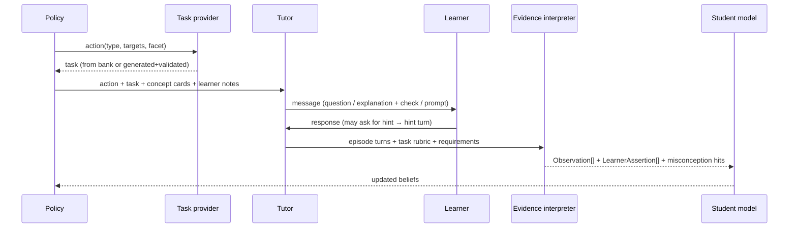

# hoc-ai — Prototype Architecture (v0.1)

> Status: architectural foundation for the first prototype. M0 and the agent-driven Graph Studio (§18) are implemented; the rest follows `IMPLEMENTATION_PLAN.md`.
> Companion documents: [`IMPLEMENTATION_PLAN.md`](IMPLEMENTATION_PLAN.md) (milestones and acceptance criteria) and [`../CLAUDE.md`](../CLAUDE.md) (conventions for implementing with Claude Code).

---

## 0. What this document decides

This document specifies a **small but complete end-to-end prototype** of an AI-native, graph-based learning system:

1. Build a concept graph from educational sources (text + problems with solutions).
2. Let an expert inspect and refine it through a prioritized review queue.
3. Tutor a learner through questions, explanations and prompts.
4. Turn each learner response into structured, auditable evidence.
5. Maintain a per-learner belief state that separates *"doesn't understand"* from *"we don't know yet"*.
6. Choose the next learning action from that belief state, with a logged rationale.
7. Evaluate all of the above offline using a gold graph and simulated learners.

Every section ends with what goes into **v0.1** and what is **deferred**. Section 14 consolidates the scope table; section 15 lists the decisions that are expensive to change later.

---

## 1. Critical assessment of the vision

The vision is sound in its emphasis — conceptual structure, evidence-based learner models, and depth over coverage. Several implicit assumptions need correcting before they turn into architecture.

### 1.1 Assumptions to correct

| Assumption in the vision | Problem | Consequence for the design |
|---|---|---|
| There is one canonical knowledge graph of a subject. | Structure depends on the learning objective and the framing (e.g. probability via counting vs. via measure theory). Prerequisites in particular are objective-relative. | One *shared* graph with typed, graded edges and an optional `scope`; learning paths are **computed per objective**, never stored as the graph. |
| Prerequisites are binary. | "You need A to learn B" ranges from *definitionally impossible without A* to *A helps*. | Prerequisite edges carry `necessity ∈ {essential, supportive}` and an evidence summary. |
| Understanding a concept is one quantity. | A learner can compute with Bayes' rule and be unable to say why it works. A single mastery score cannot express "superficial familiarity". | Belief is tracked per **(concept, facet)**, with facets `recall, apply, explain, transfer`, and per **relation** (understanding a connection is itself tracked). |
| Concept appearing in a solution ⇒ prerequisite. | Already flagged by you; it is more general: solution analysis tells us what a *task* requires, not what a *concept* requires. | Solution paths primarily produce the **task requirement model** (Q-matrix, with alternatives); concept-level edges from solutions are only proposals with evidence. |
| LLM judgements (extraction, grading) are facts. | They are noisy sensors with unknown, task-dependent reliability. | Every LLM output is stored as a *proposal* or *observation* with a judge identity and reliability weight; nothing an LLM says mutates state without passing through a typed, logged channel. |
| A personalized graph per student can be inferred. | From tens of interactions, a full personal graph is unidentifiable; it would be mostly invented. | The learner model is an **overlay** on the shared graph, plus a shared misconception library, plus sparse *learner assertions* (connections the student actually stated), plus free-text notes. Full personal graphs are deferred until evidence density justifies them. |
| More agents produce better graphs. | Free-roaming multi-agent systems are hard to debug, evaluate and reproduce. | A **deterministic pipeline of specialised LLM steps** with typed I/O, plus one bounded agentic "curator" loop for open-ended refinement. |
| Graph quality can be judged in isolation. | A graph is good if it supports good diagnosis and teaching decisions. | Evaluate the graph intrinsically (vs. a gold graph) **and** extrinsically (does the tutor diagnose simulated learners better with it?). |

### 1.2 Most promising ideas

- **Solution-path analysis** as a source of structure. Problems with worked solutions are the best available evidence of how concepts are *used*, and they directly yield assessment models.
- **Explicit misconceptions** as first-class graph objects. These are what make diagnosis and targeted remediation possible.
- **Separation of knowledge structure from observations about learning.** This prevents statistical artefacts from becoming "truth".
- **Facet profiles** (e.g. high `apply`, unknown `explain`) give a concrete, operational definition of superficial versus deep understanding.

### 1.3 Hardest research problems (not solved by this prototype, but made testable)

1. **Grain size** — what counts as one node. Wrong grain breaks everything downstream.
2. **Objective-relative dependency** — how to represent prerequisites that differ by goal without fragmenting the graph.
3. **Validity of LLM-as-grader** for open responses (explanations, reasoning steps), including misconception detection.
4. **Identifiability of learner state** from sparse, noisy, multi-target evidence.
5. **Causal vs. correlational structure** in cross-learner data.
6. **Evaluation without real learners** — simulated learners are useful but leak the model's own assumptions.

---

## 2. Design principles (invariants)

These are the rules every component must respect. They are what keeps the system modular and auditable.

1. **Proposals, not mutations.** The shared graph changes only by applying a `ChangeSet` of typed `GraphOp`s. Every ChangeSet has an author (agent+version or human), rationale, evidence links and confidence.
2. **Evidence is immutable; state is derived.** Learner `Observation`s are append-only. A learner's state is a pure function of `(observations, student-model implementation, config)` and can be recomputed at any time. This is what makes student models swappable and comparable.
3. **Four layers, never mixed:** *Knowledge* (what is true about the domain), *Assessment & pedagogy* (tasks, rubrics, objectives), *Learner* (evidence and beliefs about one learner), *Analytics* (aggregate observations across learners). Analytics may only influence Knowledge through proposals.
4. **Decide, then generate.** The policy chooses an abstract action (type, targets, facet); generators produce the natural-language content. Decisions are logged with all candidates and scores.
5. **Everything traceable.** Every LLM call is logged (model, prompt version, inputs, outputs, cost) and referenced by the records it produced.
6. **Stable identity.** Concept IDs never change meaning; merges and splits leave redirects so historical evidence stays valid.
7. **Uncertainty is explicit** everywhere: edges have confidence, beliefs have evidence mass, observations have reliability.
8. **Replaceable strategies behind narrow interfaces**: graph builders, student models, policies, graders and simulators are each a plug-in with a fixed contract.

---

## 3. System overview



**Runtime shape:** a single Python process. Components communicate by **function calls through a service layer** and by **persisted records** (ChangeSets, Observations, PolicyDecisions). There is no message bus, no microservices and no graph database in v0.1.

---

## 4. Data model

The schemas below are logical; field names are normative, storage layout is an implementation detail (see §12). All entities have `id`, `created_at`, and where relevant `created_by` (an `Actor` reference: agent name + version, or human user id).

### 4.1 Knowledge layer

#### Concept (graph node)

A node is a **knowledge unit**: the smallest unit that (a) has its own definition or statement, (b) can be assessed on its own in a few minutes, and (c) a learner could plausibly understand or fail to understand independently of its siblings. Pilot target: 40–80 nodes for the pilot domain.

| Field | Type | Notes |
|---|---|---|
| `id` | slug, e.g. `conditional-probability` | Stable, human-readable. Never reused. |
| `name`, `aliases[]` | text | Aliases drive entity resolution. |
| `kind` | `concept` \| `principle` \| `procedure` | *concept* = what something is; *principle* = a relationship that holds (theorem, law, identity); *procedure* = a method or skill. |
| `card` | ConceptCard | The AI-readable core meaning (below). |
| `topic_ids[]` | refs | Topics are grouping/navigation only and are **not** part of the dependency structure. |
| `status` | `proposed` \| `accepted` \| `deprecated` \| `merged` | `merged` nodes carry `redirect_to`. |
| `locked` | bool | Set when an expert has confirmed it; agents may only *propose* changes to locked elements, never auto-apply. |
| `version` | int | Incremented on every applied change. |

#### ConceptCard (the AI-readable representation)

This is the central representation used by generators, graders and the tutor. It is structured so that its parts can be referenced individually.

| Field | Purpose |
|---|---|
| `one_line` | One-sentence gist. |
| `definition` | Informal, precise definition or statement. |
| `formal` | Optional formal statement (LaTeX). |
| `key_ideas[]` | **Atomic propositions** with local ids (`KI1`, `KI2`…), e.g. *"Conditioning on B restricts the sample space to B and renormalises."* These are what rubrics refer to; they are the finest unit of evidence. |
| `representations[]` | Useful mental models/visualisations (tree diagram, area model) — also seeds for later rich content. |
| `examples[]`, `non_examples[]` | Positive and boundary cases. |
| `scope_conditions` | When the concept/principle applies and when it doesn't. |
| `facet_indicators` | For each facet (`recall`, `apply`, `explain`, `transfer`): a short description of what demonstrating it looks like for *this* concept. This is the concept's evidence model. |
| `misconception_ids[]` | Links to the misconception library. |
| `source_refs[]` | Evidence links to source chunks. |

#### Relation (graph edge)

Edge vocabulary is deliberately small in v0.1. It lives in a registry so new types can be added without schema changes.

| Type | Direction semantics | Pedagogical use |
|---|---|---|
| `prerequisite_of` | A → B: understanding B depends on A. Carries `necessity`: **essential** (B's definition/statement cannot be understood without A — the *definitional test*) or **supportive** (A substantially eases B; other routes exist). | Frontier computation, remediation. Must form a DAG. |
| `specializes` | A → B: A is a special case of B. | Generalisation/specialisation prompts, transfer tasks. |
| `part_of` | A → B: A is a component of B. | Decomposition when a learner fails B. |
| `contrasts_with` | symmetric: A and B are commonly confused or importantly distinct. | Comparison actions; strongly linked to misconceptions. |
| `analogous_to` | symmetric: structural analogy across contexts. | Alternative explanations, transfer. |
| `related` | symmetric: weak catch-all. | Discouraged; the validator flags overuse. |

Edge fields: `id, type, source, target, necessity?, rationale, confidence ∈ [0,1], status, locked, scope? (list of objective ids; empty = global), evidence_summary {from_text, from_solutions, from_expert, from_learners}, source_refs[]`.

`scope` is reserved in the schema now but only lightly used in v0.1 (see §14). This is cheap now and very expensive to retrofit.

#### Misconception

A shared, global library — not per-learner.

| Field | Notes |
|---|---|
| `id`, `name` | e.g. `confuse-conditional-with-inverse` |
| `statement` | The incorrect belief, phrased as the learner would hold it ("P(A\|B) and P(B\|A) are the same"). |
| `concept_ids[]`, `relation_ids[]` | Where it lives in the graph. Often attached to a `contrasts_with` edge. |
| `diagnostic_signs[]` | Observable patterns in responses that indicate it. |
| `diagnostic_task_ids[]` | Tasks designed to discriminate it. |
| `remediation_notes` | What tends to help (counterexample, contrast, representation). |
| `origin` | `source` \| `expert` \| `agent` \| `learner_aggregate`. |

#### Topic

Hierarchical grouping (`id, name, parent_id`) for navigation and for mapping source tables of contents. Not used in reasoning about dependencies.

### 4.2 Provenance layer

| Entity | Purpose |
|---|---|
| `Source` | An ingested document: title, type (`textbook`, `notes`, `paper`, `problem_set`, `web`), file hash, licence note. |
| `Chunk` | A segment of a source with a locator (page/section/paragraph), text, and a `role` classification: `definition`, `theorem`, `exposition`, `example`, `exercise`, `solution`, `other`. |
| `LLMCall` | Every model call: model id, prompt template id + version, input hash, rendered input, output, token counts, latency, cost. Referenced by everything an LLM produced. |
| `Run` | A pipeline or evaluation run: config snapshot, code version, start/end, outcome. |
| `EvidenceLink` | `(target_kind, target_id) ← (chunk_id | llm_call_id | review_id | observation_query, quote?, stance: supports | contradicts)` |
| `ChangeSet` | A group of `GraphOp`s with `author`, `run_id`, `rationale`, `confidence`, `impact`, `status: proposed | auto_applied | approved | rejected | superseded`, `review_item_id?`. |
| `GraphOp` | Typed operation: `add_concept`, `update_concept_card` (field-level patch), `merge_concepts(from, into)`, `split_concept(from, into[])`, `deprecate_concept`, `add_relation`, `update_relation`, `retype_relation`, `remove_relation`, `add_misconception`, `link_misconception`… Each op stores a before/after snapshot of what it touches. |

The current graph is the **materialisation** of all applied ChangeSets. Applied ChangeSets can be reverted by applying their inverse.

### 4.3 Assessment & pedagogy layer

#### Target reference

Everything assessable is addressed by a `TargetRef`:

```
TargetRef = { kind: concept | relation | misconception, id, facet? }
facet ∈ { recall, apply, explain, transfer }   (relations use the implicit facet "connect")
```

#### Task (assessment item)

| Field | Notes |
|---|---|
| `id`, `prompt` | Prompt may include LaTeX. |
| `task_type` | `mcq`, `numeric`, `short_answer`, `explain_why`, `predict`, `compare`, `find_counterexample`, `transfer_problem`, `worked_problem`. |
| `requirements` | The **Q-matrix row with alternatives**: a list of *approaches*, each an AND-set of `TargetRef`s with weights (`primary` 1.0 / `secondary` 0.5). `requirements = [[A.apply, B.apply], [C.apply]]` means "solvable either via A and B, or via C". Derived from solution paths when available. |
| `rubric` | Expected key ideas (refs to `ConceptCard.key_ideas`), correct answer(s), partial-credit criteria, **misconception diagnostics** (pattern → misconception id). |
| `solutions[]` | `SolutionPath` refs (below). |
| `difficulty_prior` | Rough estimate; later calibrated from data. |
| `origin` | `source` (extracted) \| `generated` \| `expert`. |
| `status` | `draft` \| `validated` \| `retired`. Generated tasks start as `draft`; an automatic solvability check (a separate LLM solves it blind and must match the key) promotes them to `validated`. |

#### SolutionPath

| Field | Notes |
|---|---|
| `task_id`, `approach_label` | e.g. "via tree diagram", "via Bayes formula". |
| `steps[]` | `{ index, text, step_type: setup | transform | compute | justify | conclude, uses: [{ ref: TargetRef | null, role: invoked | recognised | justified_by, unmapped_description? }] }` |
| `source_chunk_id` | Where the solution came from (or `generated`). |

Unmapped uses (a step relies on an idea not in the graph) are the primary signal for **missing intermediate concepts**.

#### LearningObjective

`{ id, name, targets: [TargetRef with required level], scope_note }`. The policy works relative to an objective. The relevant subgraph is computed as the targets plus their (essential, then supportive) prerequisite closure.

#### ContentItem — deferred

Pre-authored explanations, visualisations and interactive elements. In v0.1 explanations are generated on demand from concept cards and logged; nothing is stored as reusable content yet.

### 4.4 Learner layer

| Entity | Notes |
|---|---|
| `Learner` | `id`, display name, `is_simulated`, `sim_profile_id?`. |
| `Session` | A tutoring session bound to one `LearningObjective`. |
| `Episode` | One pedagogical action within a session: `action` (from the policy), `task_id?`, sequence of `Turn`s, outcome. |
| `Turn` | Raw message: `role (tutor | learner)`, text, timestamp, `hint_level`. Never edited. |
| `Observation` | **The unit of evidence.** Produced by the evidence interpreter from one or more learner turns. Fields: `learner_id, episode_id, target: TargetRef, outcome: strong | partial | absent | contradicting, weight, judge: { kind: exact | rule | llm | self_report, id, reliability }, rationale, quote, task_id?, approach_id?, hints_used, timestamp`. Append-only. |
| `LearnerAssertion` | A connection or interpretation the learner *stated* ("conditioning is like zooming in on B"): `text, mapped_refs[], validity: canonical | valid_novel | partially_valid | invalid, linked_misconception_id?`. This is the v0.1 form of a personal mental model. |
| `LearnerNotes` | Free-text, LLM-maintained narrative of the learner's apparent mental model, with every claim citing observation ids. Used as context for the tutor, **never** as input to the policy's scoring. |
| `LearnerState` | **Derived and cached**, never authoritative. Keyed by `(learner_id, student_model_id, config_hash)`. Contents defined by the student model (§8). |
| `PolicyDecision` | For every episode: the candidate actions, their component scores, the chosen action, policy id/version. Enables offline policy comparison later. |

### 4.5 Analytics layer

`AggregateFinding { kind, scope (concept/relation/task), statistic, sample_size, learner_ids_hash, period }`, e.g. "68% of learners who fail `bayes-rule.apply` also show `confuse-conditional-with-inverse`". Findings become `ChangeSet` proposals of origin `learner_aggregate`, which **always** require expert review.

### 4.6 Identity and versioning rules

- Concept and relation IDs are permanent. A merge sets `status = merged, redirect_to = X` on the absorbed node; a split creates new nodes and marks the old one `deprecated` with `split_into[]`.
- Observations reference the target ID as it was when recorded. The student model resolves redirects at read time; for splits, evidence on the old node is attached to all successors at reduced weight (configurable) and flagged.
- A **graph snapshot** (tag) can be created at any point; tutoring sessions and evaluation runs record the snapshot they ran against.

---

## 5. Graph construction pipeline

### 5.1 Approach: pipeline first, agent second

The construction system is a **deterministic orchestration of specialised LLM steps**, each with a typed input/output schema, a versioned prompt and its own evaluation. This is preferred over a multi-agent conversation because each step can be tested, cached, re-run and compared in isolation.

One genuinely agentic component exists — the **Curator** (§5.4) — for open-ended refinement tasks where the next step depends on what was found. It works through the same typed tools and can only produce ChangeSets.

### 5.2 Stages

| # | Stage | Input → Output | Notes |
|---|---|---|---|
| 1 | **Ingest** | file → `Source`, `Chunk[]` | PDF (PyMuPDF), Markdown, LaTeX-as-text. Segment by headings, then by paragraph groups (~300–800 tokens). Classify each chunk's `role` (cheap model). Exercises and solutions are paired where possible. |
| 2 | **Scope & grain** (optional, once per domain) | domain description + TOCs → `GrainGuide`, `Topic[]` | Produces a short domain-specific grain guideline with examples ("*Bayes' rule* is one node; *Bayes' rule for multiple hypotheses* is a `specializes` child") that is injected into later prompts. Reviewed by the expert once. This is the cheapest and most effective way to control grain size. |
| 3 | **Extract** (map over chunks) | chunk + grain guide → `CandidateConcept[]`, `CandidateRelation[]` | Candidates carry local definitions, quotes and the chunk id. Explicit textual dependency cues ("recall that", "using X we get", "this generalises") are captured as candidate relations with `from_text` evidence. Cheap/medium model. |
| 4 | **Consolidate** (reduce) | all candidates + existing graph → merge decisions, canonical `Concept`s with synthesised `ConceptCard`s | *Blocking*: group candidates by normalised name, aliases, lexical similarity (rapidfuzz) and embedding similarity. *Adjudication*: an LLM decides per block: `same`, `distinct`, `A specializes B`, `A part_of B`. *Synthesis*: write the concept card from all mentions with citations. Matches against existing accepted concepts become `update` proposals rather than new nodes. Strong model. |
| 5 | **Solution-path analysis** | exercise + solution chunks → `Task`, `SolutionPath[]`, task `requirements`, candidate concepts for unmapped steps | See §5.3. |
| 6 | **Relate** | concepts + neighbourhoods → `CandidateRelation[]` | Candidate pairs from: textual cues (stage 3), embedding neighbourhoods, co-use in solution paths, source ordering. For each pair an LLM classifies the relation type with a rationale, applying explicit tests: the *definitional test* for essential prerequisites ("can B's definition be stated and understood without A?"), the *substitution test* for `specializes`, the *confusion test* for `contrasts_with`. Outputs confidence. |
| 7 | **Misconception mining** | concept cards, sources, `contrasts_with` edges → `Misconception[]` | From explicit text ("a common mistake is…"), from contrasts, and from the model's knowledge of the domain (flagged as `origin: agent`, lower confidence). |
| 8 | **Validate & critique** | proposed graph state → `Issue[]` | *Deterministic checks*: prerequisite cycles; orphans; nodes with very high in-degree on `prerequisite_of` (likely too coarse); chains A→B→C plus A→C (mark as implied, keep); duplicate suspects (high similarity, no relation); concepts with no tasks; cards missing key ideas or facet indicators; overuse of `related`. *LLM critic*: reviews each topic neighbourhood for coherence, missing obvious concepts, and grain inconsistencies. |
| 9 | **Triage** | ChangeSets + issues → auto-apply or review queue | See §6. |

All stages are **idempotent and cached** by `(stage, input hash, prompt version, model)`, so re-running the pipeline after changing one prompt only recomputes what changed.

### 5.3 Solution-path analysis (in detail)

For each problem with one or more solutions:

1. **Segment the solution into steps** and classify each step's type.
2. **Map each step to the concepts/principles/procedures it uses**, with a role. If a step uses an idea that has no good match, record an `unmapped_description`.
3. **Build the task's `requirements`**: each distinct solution approach becomes one AND-set; multiple solutions yield alternatives. If only one solution is known, the requirement set is marked `alternatives_known: false` — it is a *sufficient* path, not proven *necessary*.
4. **Derive graph evidence — conservatively**:
   - *Unmapped uses* recurring across ≥2 problems → proposal for a new intermediate concept (review required).
   - *Systematic co-use* (every known solution of every problem primarily about B uses A at a core step) → adds to `from_solutions` evidence on a `prerequisite_of(A, B, supportive)` proposal. Never auto-applied as `essential`.
   - *Alternative approaches* that avoid A → **counter-evidence** against `A essential for B`.
5. **Optionally generate an alternative solution** (strong model) for problems with a single solution, specifically to test whether the observed requirements are necessary. Generated solutions are marked as such.

The key point: solution analysis is mainly an **assessment-model builder** (what does this task require, via which routes), and only secondarily a source of evidence about concept dependencies.

### 5.4 The Curator (bounded agentic loop)

A tool-using agent for tasks that are hard to pre-specify: "Fill gaps around *random variables*", "Resolve all open issues in topic *Independence*", "Integrate this new lecture-notes PDF into the existing graph".

- **Tools**: `query_graph`, `get_concept`, `search_chunks`, `get_issues`, `propose_changeset`, `ask_expert` (creates a structured review question), `run_validators`.
- **Limits**: max steps and token budget per task; cannot apply ChangeSets — only propose; triage applies the same policy as for pipeline output.
- **v0.1**: implement with a minimal tool loop on the Anthropic API. Used for incremental integration and issue resolution; the bulk build uses the pipeline.

### 5.5 Web research — deferred

A "source discovery" step that turns a subject description into candidate resources is deferred to v0.2. v0.1 works on user-provided sources, so construction quality can be evaluated on a fixed corpus first. When added, it should only *add Sources* to the corpus (with licence notes); everything downstream is unchanged.

---

## 6. Expert-in-the-loop

### 6.1 Triage rule

Each ChangeSet gets two scores:

- **Uncertainty** `u = 1 − confidence` (from the producing step; later calibrated against expert decisions).
- **Impact** `i ∈ [0,1]` from: operation kind (merge/split/deprecate/remove > retype > add), whether it touches locked elements, node centrality in the prerequisite graph, and the number of tasks/observations that reference the touched elements.

Decision:

| Condition | Action |
|---|---|
| touches a `locked` element, or op is merge/split/deprecate on an accepted node, or origin is `learner_aggregate` | **Always review** |
| `confidence ≥ τ_auto` (default 0.85) and `i ≤ i_low` (default 0.3) and no conflicting proposal | **Auto-apply** (still logged, still revertible, visible in the review UI as "auto-applied") |
| otherwise | **Review queue**, priority = `i × u` |

### 6.2 Review items

Three kinds, all rendered in the review UI:

1. **ChangeSet review** — approve / reject / edit. Shows ops as a diff, rationale, evidence quotes, and the local neighbourhood before and after.
2. **Structured question** — the system asks a concrete question with options: *"Is `conditional-probability` essential for `independence` (definitional), supportive, or unrelated, for the objective 'Intro probability'?"* Answers generate a ChangeSet authored by the expert.
3. **Issue** — a validator finding the expert can resolve, dismiss, or delegate to the Curator.

**Batching**: questions on the same neighbourhood are grouped so the expert decides with shared context. The queue is sorted by priority; the expert sets a session budget ("show me the 20 most important").

### 6.3 Expert decisions as data

- Approved/edited elements become `locked`.
- Every decision is stored with the proposal it judged, forming a labelled dataset `(proposal type, producing step, confidence, decision)`. In v0.1 this feeds a **calibration report** (acceptance rate by step and confidence bucket). In later versions it calibrates `τ_auto` per proposal type so expert load drops as trust is earned.
- Experts can also edit directly (graph editor) — this creates an expert ChangeSet like any other.

---

## 7. Assessment and evidence

### 7.1 How interactions produce evidence



### 7.2 Evidence interpreter

Given the task, its rubric and requirements, the concept cards involved and the learner's turns, it outputs (structured, one LLM call for open responses; deterministic for `mcq`/`numeric`):

- `approach_id` — which solution approach the learner used (or `novel`/`unclear`). Evidence is attributed to the targets **of that approach**, not of all approaches.
- `observations[]` — per target ref: outcome (`strong`, `partial`, `absent`, `contradicting`), quote, rationale. `absent` means the task called for it and the learner didn't show it; it is weak negative evidence.
- `key_ideas_shown[]` / `key_ideas_missing[]` — by key-idea id.
- `misconception_hits[]` — misconception id + quote + confidence; plus **misconception non-hits** when a diagnostic task was answered in a way that rules the misconception out.
- `assertions[]` — learner-stated connections/interpretations with validity judgement.
- `unmapped_reasoning` — reasoning the learner used that matches nothing in the graph (feeds analytics).
- `feedback_for_tutor` — what to say next (used by the tutor, not stored as evidence).

**Weights**: `weight = judge_reliability × requirement_weight × hint_discount × guess_correction`
- `judge_reliability`: exact = 1.0, rule = 0.9, llm = 0.7 (initial; to be calibrated against expert-graded samples), self_report = 0.2.
- `hint_discount = 1 / (1 + hints_used)`.
- `guess_correction` for MCQ successes: `1 − 1/k` for k options.

### 7.3 Assessing depth rather than familiarity

Depth is assessed by **which facets** have evidence and by task types designed to elicit them:

| Facet | Elicited by | Distinguishes |
|---|---|---|
| `recall` | define, recognise, state | familiarity |
| `apply` | standard problems, computations | procedural competence |
| `explain` | `explain_why`, `predict` (then explain), self-explanation prompts after a correct answer | conceptual grounding |
| `transfer` | `transfer_problem` in an unfamiliar context, `find_counterexample`, problems where the standard procedure doesn't apply | flexible, generalisable understanding |
| `connect` (on relations) | `compare`, "how does A relate to B", analogy tasks | integrated knowledge structure |

**Superficial familiarity** is then an operational pattern: `apply` (or `recall`) belief high **and** `explain`/`transfer` low *or unknown*. "Fragile" knowledge is success only with hints. Both are flags the policy reacts to.

---

## 8. Student model

### 8.1 Interface (contract every student model implements)

| Operation | Meaning |
|---|---|
| `init(learner, graph_snapshot, config) → State` | Prior state. |
| `update(State, Observation[]) → State` | Pure function; must be deterministic. |
| `belief(State, TargetRef, at_time) → Belief` | `Belief = { mean, evidence_mass, status, observed: bool, inferred_mean? }` |
| `predict(State, Task, at_time) → P(success)` | Used for task selection and for model evaluation (predictive log-loss on held-out responses). |
| `misconceptions(State) → [(id, p_present, evidence_mass)]` | |
| `explain(State, TargetRef) → text` | Which observations drive this belief (for the learner inspector UI). |

`status ∈ { unknown, likely_not, uncertain, likely, mastered }` — **`unknown` (insufficient evidence) is structurally distinct from `likely_not`** (evidence of non-understanding).

### 8.2 Default model for v0.1: `beta-facet`

Simple, interpretable and good enough to make the rest of the system testable.

- **State**: for each `(target, facet)` a Beta(α, β) with prior Beta(1, 1); for each misconception a Beta for "present".
- **Update** for an observation with weight `w`:
  - `strong`: α += w
  - `partial`: α += 0.5 w, β += 0.5 w
  - `absent`: β += 0.3 w
  - `contradicting`: β += w
- **Evidence mass** `m = α + β − 2`. Status thresholds (configurable): `m < 1.0 → unknown`; else by posterior mean: `< 0.35 likely_not`, `< 0.65 uncertain`, `< 0.85 likely`, else `mastered` (and `m ≥ 2.5` required for `mastered`).
- **Forgetting**: evidence decays rather than flipping to "not known": at read time, the counts above the prior are multiplied by `2^(−Δt / h)` (default half-life `h` = 14 days; per-facet override). A long-unpractised concept therefore drifts back towards `unknown`/`uncertain`, which is the honest statement.
- **Cross-facet propagation** (small, configurable): `transfer.strong` adds 0.3 w to `apply` and `explain`; `explain.strong` adds 0.2 w to `recall`; `recall.contradicting` adds 0.3 w to β of `apply` and `explain`.
- **Graph-informed priors (inferred, not observed)**: for targets with `m < 1`, `inferred_mean` is computed from essential prerequisites (e.g. capped by the minimum prerequisite mean). It is reported separately, used by the policy to order candidates, and **never** counted as evidence or displayed as mastery.
- **Misconceptions**: hit → α += w; diagnostic non-hit → β += w.

### 8.3 Baselines and alternatives (pluggable)

- `flat-beta`: one Beta per concept, no facets — the ablation that shows whether facets matter.
- `bkt`: classic Bayesian Knowledge Tracing per `(concept, facet)` with fixed parameters.
- `llm-belief`: an LLM reads the observation log and outputs beliefs — an interesting, expensive comparison.
- Later: IRT/Elo with task difficulty, cognitive-diagnosis models (DINA-style over the Q-matrix with alternatives), Bayesian networks over the prerequisite DAG, deep knowledge tracing once data exists.

Because state is derived from the observation log, every model can be run on the same logs (**replay**) and compared on predictive accuracy and calibration.

### 8.4 Individual mental models in v0.1

Represented by three things, in increasing order of interpretive freedom:

1. The **facet profile overlay** on the shared graph (quantitative).
2. **Misconception beliefs** against the shared library, plus **LearnerAssertions** — connections the learner actually expressed, judged for validity (structured).
3. **LearnerNotes** — narrative, citation-backed, used only as tutoring context (qualitative).

`valid_novel` assertions and recurring `unmapped_reasoning` are the raw material for future personal graphs and for alternative pathways in the shared graph.

---

## 9. Adaptive policy and the tutoring loop

### 9.1 Action space (v0.1)

| Action | Targets | When it is a candidate |
|---|---|---|
| `probe` | (concept, facet) | Target relevant to objective and `status = unknown` — gather evidence. |
| `practice` | (concept, `apply`) | In the learning frontier (see below), not yet `likely`. |
| `explain_then_check` | concept | Frontier concept with `likely_not`, or after failed practice. Explanation is followed by a check question — an explanation alone produces no evidence. |
| `self_explain` | (concept, `explain`) | Superficial-familiarity pattern: `apply` ≥ likely, `explain` unknown/low. |
| `contrast` | `contrasts_with` edge | One side confused, or a linked misconception is active. |
| `remediate_misconception` | misconception | `p_present > 0.5` with `m ≥ 1`: counterexample or cognitive-conflict task, then a diagnostic re-check. |
| `review_prerequisite` | prerequisite concept | Learner failing a target whose essential prerequisite is `uncertain`/`unknown`/`likely_not`. |
| `transfer_challenge` | (concept, `transfer`) | `apply` and `explain` ≥ likely, `transfer` unknown. |
| `spaced_review` | (concept, facet) | Previously `likely`/`mastered`, decayed below threshold. |

**Learning frontier** for an objective: targets in its closure that are not yet `likely`, whose essential prerequisites are each `likely` or better (or `inferred_mean ≥ 0.6` if unobserved).

### 9.2 Policy: candidate generation + transparent scoring

```
score(a) = w_info · info_gain(a)            # expected variance reduction of target beliefs
         + w_learn · learning_value(a)       # frontier membership, objective relevance
         + w_misc · misconception_urgency(a)
         + w_depth · depth_gap(a)            # facet-profile gaps (shallow pattern)
         + w_space · spacing_due(a)
         − w_rep · recent_repetition(a)      # avoid hammering the same target
```

- `info_gain` uses the Beta variance reduction expected from one observation of typical weight.
- Weights live in config. Every decision writes a `PolicyDecision` with all candidates and score components, so behaviour is explainable in the UI and policies can be compared offline.

**Baselines** behind the same interface: `random`, `prerequisite-order` (topological order over the objective closure; advance when `likely`), and `llm-policy` (an LLM picks from the candidate list given a state summary). Bandit/POMDP/RL policies are deferred (§14); the logged decisions are the dataset they will need.

### 9.3 Task provider

1. Look up validated tasks in the bank whose requirements include the action's target/facet, preferring tasks where the target is primary, the predicted success is in a useful band (roughly 0.4–0.8 for practice; any for probes), and the learner hasn't seen it recently.
2. Otherwise **generate**: the task generator receives the concept card(s), facet indicators, misconception (if any) and task type, and must output prompt, rubric (with key-idea refs and misconception diagnostics) and requirements. Then a **blind solve check** runs before use. Generated tasks are saved to the bank.

### 9.4 Tutor renderer

Turns `(action, task, concept cards, learner notes, recent turns)` into the actual message, handles hint requests (graded hint levels, recorded on the turn) and follow-ups within the episode, and closes the episode. The tutor may answer learner-initiated questions grounded in concept cards; such questions are logged and passed to the evidence interpreter as weak evidence (what a learner asks reveals what they're missing).

The tutor **never** updates beliefs directly and never decides the next action — that separation is what makes policies comparable.

### 9.5 Session loop

```
start session(learner, objective)
loop:
  state     ← student_model.replay(observations)          # cached incrementally
  decision  ← policy.decide(state, graph, task_bank, objective)
  task      ← task_provider.get(decision.action)
  episode   ← tutor.run_episode(decision.action, task)     # 1..k turns with learner
  obs       ← evidence_interpreter.interpret(episode, task)
  persist(episode, obs, decision)
until objective reached (all targets ≥ required level) or learner stops
```

---

## 10. Cross-learner feedback (minimal in v0.1)

v0.1 implements an **analytics report** and a **proposal generator**, run manually over the observation store (real or simulated learners):

- Per misconception: prevalence, co-occurring failures → candidate new `misconception` links or `contrasts_with` edges.
- Per task: approach distribution, frequent `unmapped_reasoning` → candidate intermediate concepts or alternative solution paths.
- Per essential prerequisite edge `A → B`: learners who reach `B ≥ likely` while `A` is `likely_not` → **counter-evidence** that A is essential (proposes downgrade to supportive).
- Per concept: chronic difficulty despite prerequisites → possibly too coarse (split proposal) or missing prerequisite.

All of these produce `ChangeSet`s with origin `learner_aggregate` and the statistic attached as evidence; they always go to expert review. The design point is that **observations about learning stay in the analytics layer** and only an expert-reviewed proposal can change the knowledge layer.

---

## 11. Evaluation harness (part of v0.1, not an afterthought)

### 11.1 Gold graph

A small expert-built reference graph for the pilot domain (≈30–50 nodes, typed edges, ~10 misconceptions). It is authored through the same ChangeSet mechanism (expert author) into a separate graph namespace.

**Construction metrics**: node alignment (LLM-assisted matching, expert-spot-checked), edge precision/recall per type, prerequisite-necessity agreement, misconception coverage, structural validator counts, expert acceptance rate and review load (items per 10 nodes).

### 11.2 Simulated learners

A simulated learner has a **hidden ground-truth state** defined over the gold graph: which (concept, facet) pairs it knows, which misconceptions it holds, a slip/guess rate, and simple learning rules (e.g. a successful `explain_then_check` on a frontier concept flips it to known with probability p). An LLM role-plays responses **constrained by that state** (it receives the hidden state and is instructed to answer consistently with it, including misconception-driven errors).

Metrics:
- **Diagnosis**: calibration (Brier/ECE) and accuracy of `belief` vs. hidden state; interactions needed to detect each planted misconception.
- **Policy**: simulated learning gain per N episodes, objective completion time — for each policy.
- **Model comparison**: predictive log-loss of `predict` on held-out responses via replay.

Caveat (documented in reports): simulators share assumptions with the system and are LLM-noisy. They are for regression tests, debugging and *relative* comparisons, not for claims about real learners. A small pilot with real learners is the first step after v0.1.

### 11.3 Grader validation

A small expert-graded set of open responses (≈50–100, partly from simulated learners, partly hand-written) to measure the evidence interpreter's agreement per outcome category and misconception detection precision/recall. This sets `judge_reliability` for LLM grading.

---

## 12. Technology and code structure

### 12.1 Choices

| Concern | Choice | Rationale / swap path |
|---|---|---|
| Language | Python 3.12, managed with `uv` | Ecosystem for LLMs, graphs, data. |
| Schemas | Pydantic v2 | Single source of truth for domain types, LLM structured outputs and persistence. |
| Storage | SQLite (SQLAlchemy 2 / SQLModel), JSON columns for cards and op payloads | Zero-ops, file-based, easy to snapshot/copy. Repository interfaces allow Postgres later. |
| Graph algorithms | NetworkX over the materialised graph, loaded in memory | Graph is small (≤ thousands of nodes). No graph DB in v0.1. |
| Embeddings | `fastembed` (small local ONNX model) behind an `Embedder` interface; vectors in SQLite, brute-force numpy search | No vector DB needed at this scale. |
| Fuzzy matching | `rapidfuzz` | Cheap blocking for entity resolution. |
| LLM | Anthropic API via official SDK behind an `LLMClient`; structured outputs via tool-use with Pydantic schemas; tiered models configured per step (e.g. `claude-haiku-5-5` for chunk classification/extraction, `claude-sonnet-5-5` for most steps, `claude-opus-5-5` for consolidation, critic and grader validation) | Provider-agnostic interface; disk + DB cache keyed by input hash for reproducibility and cost. |
| Prompts | Versioned files in `prompts/<step>/<version>.md` with a header declaring input/output schema | Prompt changes are visible in diffs and recorded on every `LLMCall`. |
| PDF parsing | PyMuPDF | Swap for a layout/LaTeX-aware parser later. |
| CLI | Typer | Pipeline runs, evals, exports. |
| UI | Streamlit multipage app calling the service layer in-process; graph view via a Cytoscape.js component | Fastest route to a usable explorer, review queue and tutor chat. The service layer is the boundary: a FastAPI + React front end can replace it without touching core logic. |
| Math rendering | KaTeX (Streamlit's markdown supports LaTeX) | |
| Tests | pytest; LLM steps tested with recorded fixtures (cached calls) plus a small live "smoke" suite | |

Explicitly **not** in v0.1: Docker, Neo4j, vector databases, message queues, auth, multi-tenancy, LangChain-style frameworks.

### 12.2 Package layout

```
hoc-ai/
  CLAUDE.md
  pyproject.toml
  config/
    default.yaml            # thresholds, weights, model tiers, half-lives
    domains/probability.yaml
  prompts/                  # versioned prompt templates, one folder per step
  data/
    sources/                # input documents (gitignored if licensed)
    gold/                   # gold graph + graded responses
    hoc.db                  # SQLite (gitignored)
  src/hoc/
    core/                   # domain types (pydantic), ids, TargetRef, Actor, errors
    store/                  # repositories, ChangeSet application/materialisation, snapshots
    llm/                    # LLMClient, prompt registry, cache, call logging, cost tracking
    ingest/                 # parsers, segmentation, chunk role classification
    construct/              # pipeline stages, consolidation, relation proposal,
                            #   solution analysis, misconception mining, validators, curator
    review/                 # triage, review queue, structured questions, calibration report
    assess/                 # task bank, task generator, blind-solve check, evidence interpreter
    learner/                # StudentModel interface; beta_facet, flat_beta, bkt, llm_belief
    policy/                 # Policy interface; heuristic, random, prereq_order, llm_policy
    tutor/                  # session/episode orchestration, renderer, hints
    analytics/              # aggregate findings → proposals
    eval/                   # gold-graph comparison, simulated learners, replay, reports
    services/               # façade used by CLI and UI (the API boundary)
    cli.py
  app/                      # Streamlit pages
    1_Sources.py
    2_Graph_Explorer.py
    3_Review_Queue.py
    4_Tutor.py
    5_Learner_Inspector.py
    6_Runs_and_Evals.py
  tests/
```

Dependency rule: `core ← store ← {llm, ingest} ← construct/review/assess/learner/policy ← tutor/analytics/eval ← services ← {cli, app}`. `learner` and `policy` must not import `llm` directly except in their LLM-based variants, which receive an `LLMClient` by injection.

### 12.3 Storage tables (logical)

`sources, chunks, llm_calls, runs, concepts, concept_redirects, relations, misconceptions, topics, changesets, graph_ops, evidence_links, review_items, snapshots, tasks, solution_paths, objectives, learners, sessions, episodes, turns, observations, learner_assertions, learner_notes, policy_decisions, learner_state_cache, aggregate_findings`

The knowledge tables (`concepts`, `relations`, `misconceptions`) are the **materialised view** of applied ChangeSets; they can be rebuilt from `changesets` + `graph_ops`.

---

## 13. Component contracts

The prototype is modular through these interfaces. Each has at least two implementations in v0.1 (one real, one baseline) so the plug-in seam is exercised from the start.

| Interface | Key operations | v0.1 implementations |
|---|---|---|
| `PipelineStage` | `run(inputs, ctx) → outputs` (typed, cached, idempotent) | one per stage in §5.2 |
| `GraphBuilder` | `build(sources, graph, config) → ChangeSet[]` | `pipeline` (full), `toc-baseline` (one node per section, prerequisite = order) — the baseline makes the value of the pipeline measurable |
| `Validator` | `check(graph) → Issue[]` | structural checks, LLM critic |
| `Triage` | `route(changeset) → auto_apply \| review(priority)` | threshold rule |
| `TaskProvider` | `get(action, learner_state) → Task` | bank-first-then-generate |
| `EvidenceInterpreter` | `interpret(episode, task) → InterpretationResult` | exact/rule for closed tasks, LLM for open responses |
| `StudentModel` | §8.1 | `beta-facet`, `flat-beta`, `bkt` (`llm-belief` optional) |
| `Policy` | `decide(state, graph, bank, objective) → PolicyDecision` | `heuristic`, `random`, `prerequisite-order` (`llm-policy` optional) |
| `Tutor` | `run_episode(action, task, io) → Episode` | LLM renderer; `io` is either the UI or a simulated learner |
| `LearnerSimulator` | `respond(turns, hidden_state) → text`, `learn(episode)` | LLM-constrained simulator |

The `io` abstraction on the tutor is what lets the same loop run against a human in the UI and against a simulator in batch evaluation.

---

## 14. Prototype scope vs. deferred

| Area | v0.1 (build now) | Deferred (v0.2+) |
|---|---|---|
| Domain | One pilot domain (§17), ~5–10 sources incl. problem sets with solutions | Multiple domains, cross-domain linking |
| Sources | User-provided PDF/Markdown | Web research & source discovery agent; OCR; LaTeX-aware/layout parsing; videos |
| Nodes | concept / principle / procedure; concept cards with key ideas and facet indicators | Richer node kinds (representations, skills hierarchies), learned grain-size control |
| Edges | 6 types; `necessity` on prerequisites; `scope` field present, used only to tag objective-specific edges manually | Objective-conditioned prerequisite structure as a first-class mechanism; edge weights learned from data |
| Construction | Pipeline stages 1–9; solution-path analysis; misconception mining; Curator for incremental integration | Multi-agent debate/ensembles; active source acquisition; automatic split/merge refactoring at scale |
| Expert loop | Review queue, structured questions, locking, calibration report | Learned per-type auto-apply thresholds; multiple experts with disagreement handling; expert reputation |
| Assessment | 9 task types, text only; task generation with blind-solve validation; LLM evidence interpreter | Step-by-step input with per-step grading, interactive/visual tasks, code tasks, voice |
| Learner model | `beta-facet` + baselines; misconceptions; assertions; notes; replay | Bayesian networks over prerequisite DAG, DINA-style cognitive diagnosis, DKT/transformer KT, explicit personal graphs |
| Policy | Heuristic scoring + baselines; logged decisions | Bandits (e.g. ZPD-style), POMDP planning, offline RL from logged decisions, multi-session curriculum planning |
| Content | On-demand generated explanations (logged) | Stored content items, images, interactive visualisations, animations |
| Analytics | Manual report + proposal generator | Continuous monitoring; causal analysis; A/B experimentation |
| Evaluation | Gold graph, simulated learners, grader validation, replay | Real-learner pilots, pre/post tests, concept-inventory benchmarks |
| Platform | Single-user local app, SQLite | Multi-user, auth, deployment, Postgres, API service |

---

## 15. Fundamental decisions (expensive to change later)

1. **Proposal/ChangeSet-based graph mutation with provenance.** Retrofitting provenance onto a directly-mutated graph is nearly impossible.
2. **Immutable observations; derived learner state.** Enables replay, model swapping and honest comparison. Mixing state and evidence would lock in one student model.
3. **`TargetRef` with facets, and relations as assessable targets.** Every task, rubric, observation and belief is keyed by it.
4. **Task requirements as alternatives of AND-sets (Q-matrix with approaches).** Changing the assessment model's shape later invalidates the task bank and observation attribution.
5. **Stable IDs with redirects for merges/splits.** Learner evidence must survive graph refactoring.
6. **Layer separation** (knowledge / assessment / learner / analytics) and the rule that analytics only writes proposals.
7. **Decision/generation separation** in tutoring, with logged `PolicyDecision`s.
8. **The edge registry and the `necessity` + `scope` fields on prerequisites.** Adding a new edge type is cheap; changing what `prerequisite_of` *means* is not.

Cheap to change: storage engine, UI framework, LLM provider and model tiers, embedding model, prompts, thresholds and weights, specific student-model and policy algorithms, the exact list of task types.

---

## 16. Research directions worth investigating

- **Evidence-Centered Design** (Mislevy et al.): the student model / evidence model / task model split is essentially the assessment architecture adopted here; it is the right vocabulary for rubrics and facets.
- **Knowledge-Learning-Instruction framework and knowledge components** (Koedinger et al.), and **Learning Factors Analysis** — data-driven refinement of knowledge-component models; directly relevant to §10.
- **Knowledge Space Theory** (Doignon & Falmagne; used in ALEKS): learner states as feasible knowledge sets constrained by prerequisites; a principled alternative to the frontier heuristic.
- **Knowledge tracing**: BKT (Corbett & Anderson), Performance Factors Analysis, IRT/Elo, Deep Knowledge Tracing and later transformer-based variants.
- **Cognitive diagnosis models** (DINA/DINO, with Q-matrices) — fit naturally with alternative requirement sets.
- **Conceptual change and misconception research** (e.g. Chi's work on misconceptions as categorical mistakes; concept inventories such as the Force Concept Inventory) for misconception representation and diagnostic task design.
- **ICAP framework** (Chi & Wylie) and the **self-explanation effect**: theoretical support for preferring constructive/interactive actions (`self_explain`, `compare`) over passive explanation.
- **Spacing and desirable difficulties** (Bjork) for the forgetting model and `spaced_review`.
- **Prerequisite-relation learning from text** and concept-map extraction (NLP literature on concept prerequisite chains).
- **Sequential decision-making for tutoring**: POMDP-based teaching (e.g. Rafferty et al.), multi-armed bandits for ITS (e.g. ZPDES), offline policy evaluation from logs.
- **LLMs as graders and as simulated students**: reliability, calibration and failure modes; this is where the prototype can contribute original results.

Concrete research questions the prototype can answer:
1. Does solution-path analysis improve prerequisite precision over text-only extraction (vs. gold graph)?
2. How much expert time does uncertainty×impact triage save at equal final graph quality?
3. Do facet-level beliefs diagnose simulated learners better than per-concept beliefs (`beta-facet` vs `flat-beta`)?
4. Does the heuristic policy detect planted misconceptions in fewer interactions than prerequisite-order?
5. How reliable is LLM evidence interpretation for `explain` and `transfer` responses?

---

## 17. Pilot domain recommendation

**Introductory probability** (sample spaces, events, conditional probability, independence, law of total probability, Bayes' rule, random variables, expectation, variance, common distributions).

Why: compact (≈50 concepts), rich and well-documented misconceptions (inverse conditional confusion, independent vs. disjoint, base-rate neglect, gambler's fallacy, linearity of expectation misuse), abundant problems with worked solutions, multiple solution approaches per problem (tree diagrams vs. formulas vs. counting), and a clear difference between procedural and conceptual understanding. An alternative with similar properties is introductory linear algebra (eigenvalues/eigenvectors and their prerequisites).

---

## 18. Addendum (v0.2): agent-driven graph building and the Graph Studio

Supersedes §5.1's "pipeline first" for *graph construction* and §12.1's UI choice. See ADRs 0005–0007.

**Flow.** Brief (+ optional PDF/text at any time) → planner → builders per area → review rounds
(critic → tester writes and traces questions → refiner acts on feedback) → stable. Expert input
(feedback, directives, answers, sources, direct edits) re-enters at any time and is handled first.

```
Expert ──brief/sources/feedback/edits──►  TopicWorkspace ──► BuildEngine ◄── Runner (pause/step)
                                            │                 │  coordinator → agent.run → AgentResult
Studio UI ◄── SSE events ◄── EventLog ◄─────┘                 ▼
                                               proposals → compile → preview → triage ─► ChangeSet
```

**Run modes** (changeable while running): *manual* (expert approves every proposal), *ask* (agents
apply confident non-structural changes and ask about the rest; they may also ask questions),
*auto* (everything applies, nothing blocks). Pausing stops after the current step.

**Observability.** Every step emits events: `agent.started/finished`, `changeset.proposed/applied/
rejected/reverted` (with an element-level diff: added/updated/removed concepts and relations),
`feedback.*`, `question.asked`, `blueprint.updated`, `test.created/traced`, `run.status`.
The graph view animates diffs, colours by area/status/kind, and any earlier graph state can be
shown (`graph_at`, derived from recorded before-states — nothing extra is stored).

**Testing the graph.** A `GraphTest` is a question. The tester traces it: per solution step, which
concepts it uses and what is missing; gaps become feedback addressed to the graph. Traces are
stored per graph version and can be overlaid on the graph.

**Extension seams** (all selected in config): `agents.team` (role → registered agent),
`agents.coordinator`, `agents.triage`, `llm.providers` / `BACKEND_KINDS`, ingest `PARSERS`,
`construct.validators.VALIDATORS`. Prompts are versioned files in `prompts/agent_*/`.

**Not yet:** objective-relative prerequisites (`scope` stays unused), solution-path analysis
(§5.3), embeddings-based entity resolution, learner/tutor layers (M4+). The agents currently see
the whole graph in each prompt, which suits a few hundred nodes; larger graphs need
neighbourhood selection in `construct.context`.

---

## 19. Addendum (v0.3): the learning side

Implemented per [`LEARNING_SIDE_PLAN.md`](LEARNING_SIDE_PLAN.md) and ADRs 0008–0011: learner data in the
topic file with insert-only evidence; student models and policies behind registries; a one-call,
validated, budgeted tutor turn; an exercise bank matched by agents; super-nodes as a view. The
Studio (§18) and the Learn side share only the topic and its graph. Everything observable: every
tutor turn stores its context sizes, offered moves, raw output, evidence and cost.
